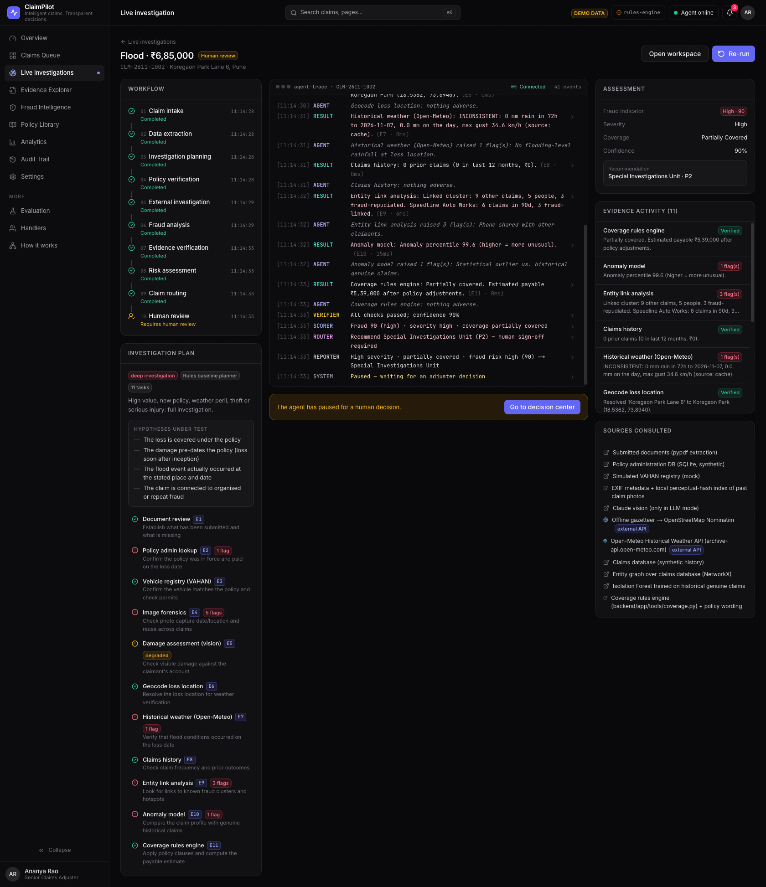
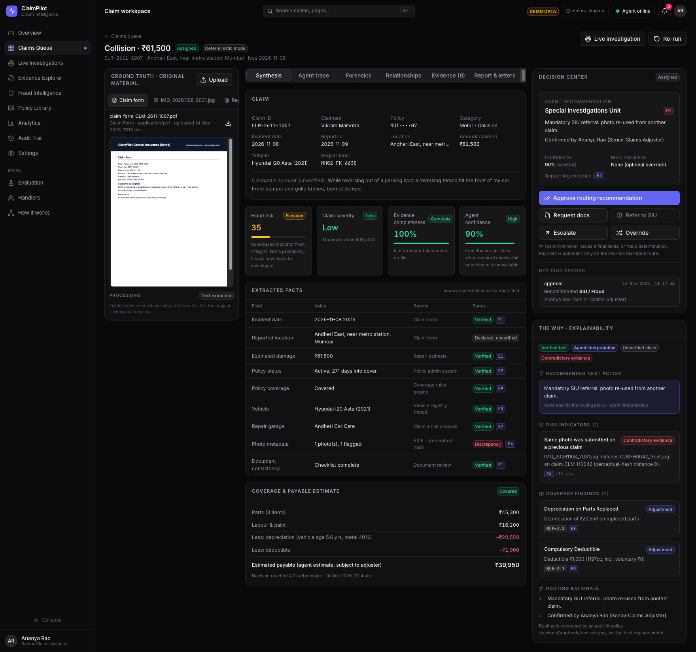
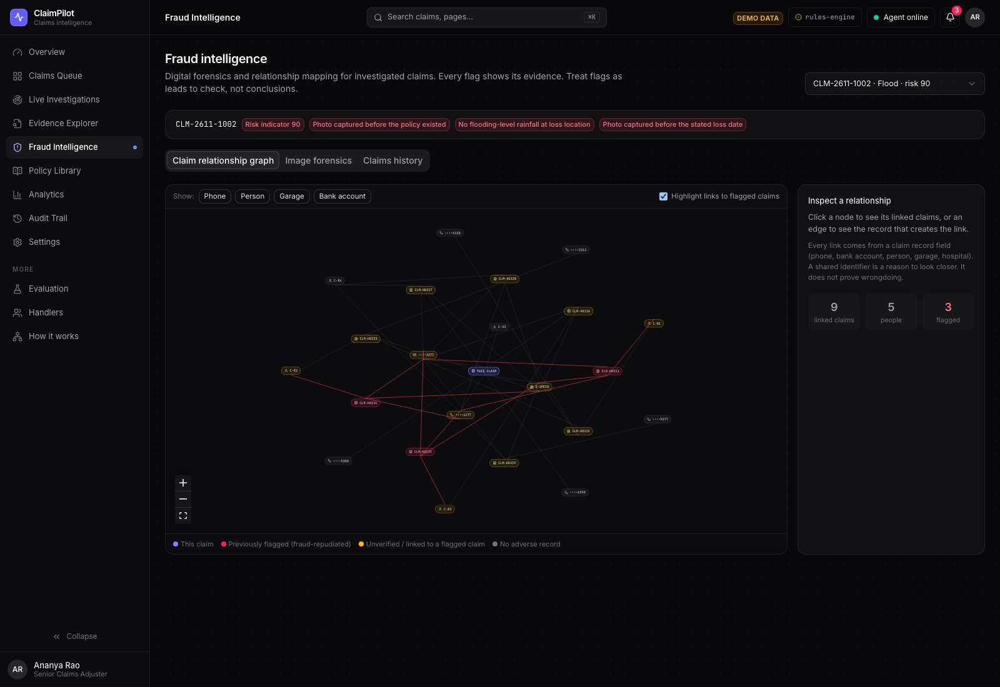
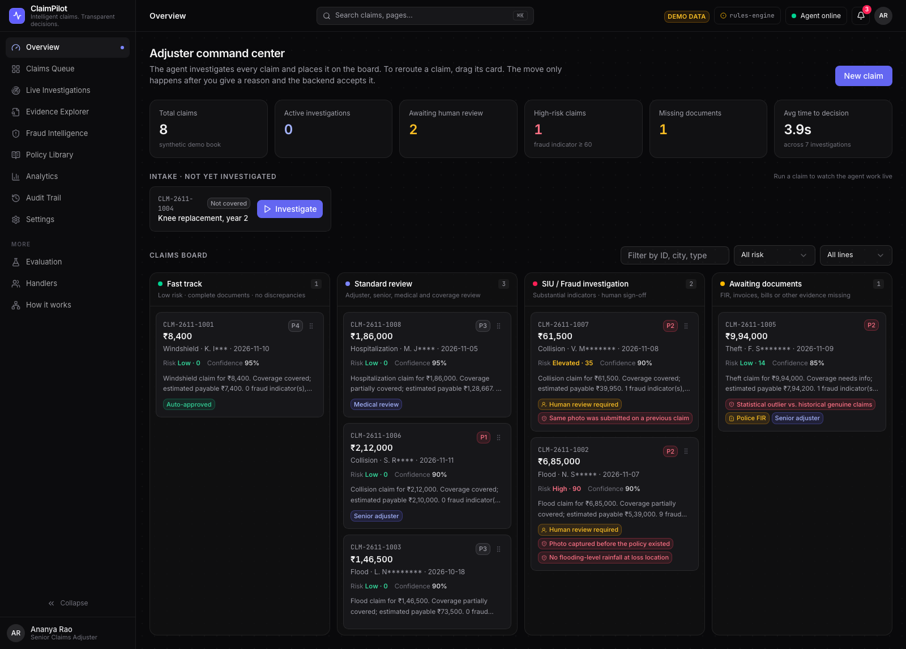
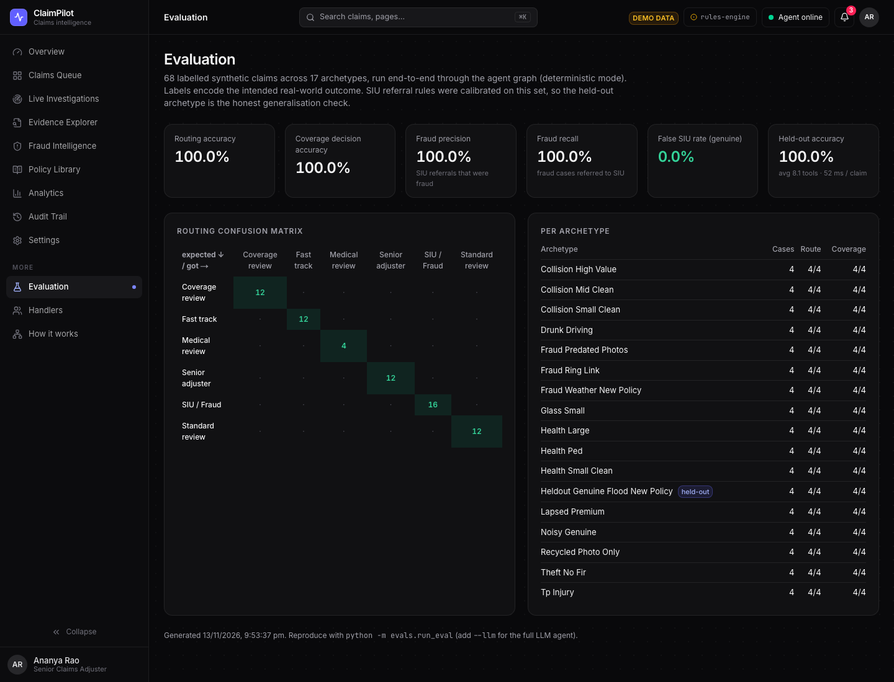

# ClaimPilot — Autonomous Claims Triage Agent

**Agentic AI Hackathon · Track: Claims Triage Agent (Insurance)**

ClaimPilot reads an insurance claim (form, free-text account, photos, PDFs), **plans an investigation, calls tools, checks its own work**, and returns a **severity, coverage and fraud-risk assessment**. It then **routes the claim to the right handler and carries out the actions**: ticket, assignment, SLA, notifications, payment for straight-through claims. It stops for a human before any denial or fraud referral.

> A triage desk spends days per claim reading documents, checking the policy, hunting for fraud signals and deciding who handles it. ClaimPilot does it in seconds and cites the evidence for every conclusion.



---

## Contents

1. [Why it matters](#why-it-matters)
2. [Features](#features)
3. [How the agent works](#how-the-agent-works)
4. [Tech stack](#tech-stack)
5. [Quick start](#quick-start)
6. [Demo scenarios & script](#demo-scenarios--script)
7. [Evaluation](#evaluation)
8. [Project structure](#project-structure)
9. [Configuration](#configuration)
10. [API reference](#api-reference)
11. [Testing](#testing)
12. [Data](#data)
13. [Troubleshooting](#troubleshooting)
14. [Known limitations](#known-limitations)
15. [Disclosure: AI coding assistant](#disclosure-ai-coding-assistant)
16. [License](#license)

---

## Why it matters

| Today | With ClaimPilot |
|---|---|
| Every claim is read manually, simple or not | Low-risk, covered, documented claims are **auto-approved**; people focus on the hard ones |
| Fraud checks depend on the handler's instinct | Weather, photo metadata, re-used images, shared phones and bank accounts and anomaly scores are checked on **every** claim |
| Coverage calls vary by handler | A rules engine applies the **policy wording clause by clause** and shows the arithmetic |
| Missing documents stall claims silently | The agent **requests them, waits, and re-plans** the moment they arrive |
| "Why was this flagged?" is hard to answer | Every score traces to flags, every flag to an evidence id, every decision to an audit event |

---

## Features

**Agentic core**
- **Risk-proportionate planning:** light, standard or deep investigation, with explicit hypotheses ("the flood actually occurred at this place and date"). A ₹8,400 windshield gets 5 checks; a ₹6.85L flood on a 6-day-old policy gets 11.
- **Tool-use loop:** Claude calls tools (in parallel where independent), reads results, adapts, and records **facts** and **findings** that must cite evidence ids. Uncited ones are rejected.
- **Verifier (critic):** checks that required evidence exists, citations are valid, and coverage reflects the latest facts. Sends gaps back for re-investigation (max 2 loops).
- **Human-in-the-loop interrupts:** pauses for missing documents (then re-plans) and for human sign-off on SIU referrals, denials and low-confidence decisions. Paused state is check-pointed and survives restarts.
- **Actions:** ticket, handler assignment (role → line → authority → region → caseload), SLA, handler and claimant notifications, payment queueing.

**13 investigation tools**

| Tool | What it does |
|---|---|
| Policy admin lookup | Status, period, premium, insured vehicle/members, add-ons, days since inception |
| Coverage rules engine | Clause-cited checks; payable with depreciation, deductible, IDV cap, total loss, room-rent proportionate deduction, co-pay, sub-limits, waiting periods |
| Policy wording search | TF-IDF retrieval over policy wording |
| Document review | PDF text extraction, classification, field parsing, mandatory-document checklist, cross-checks (amount vs bill, FIR dates) |
| Image forensics | EXIF capture time & GPS vs loss and policy dates, editing software, **perceptual-hash match against every past claim photo** |
| Damage assessment | Claude vision: damaged parts, impact direction, consistency with the account |
| Historical weather | **Live Open-Meteo archive API**: was there actually a flood, storm or hail? |
| Geocoding | Offline gazetteer, then OpenStreetMap Nominatim |
| Vehicle registry | VAHAN-style registration lookup (mocked), commercial permits |
| Claims history | Frequency, prior fraud outcomes |
| Entity link analysis | NetworkX graph over people, phones, bank accounts, garages, hospitals; finds fraud clusters and hotspots |
| Anomaly model | Isolation Forest trained on historical genuine claims |
| Ticketing & notify | Queue, priority, SLA, handler, claimant messages |

**Glassbox dashboard (dark enterprise UI: Next.js, shadcn/ui, React Flow, Recharts, Framer Motion)**
- **Overview / command center:** live metrics plus a 4-column Kanban (Fast track, Standard review, SIU, Awaiting documents). Dragging a card opens a reason dialog; the card moves only after the backend accepts.
- **Live investigation:** 10-stage workflow stepper, terminal-style trace of real SSE events (auto-reconnect), clickable tool calls with input, output, duration and source, plan with hypotheses, evidence activity and sources consulted.
- **Three-pane claim workspace:** *Ground truth* (PDF/image viewer with zoom, metadata, upload) · *Agent synthesis* (scores with plain-language explanations, extracted facts with source and verification status) · *The why* (risk indicators, agent findings, coverage findings with verbatim clause hover-cards, missing info, routing rationale).
- **Human-in-the-loop decision center:** approve, request documents, refer to SIU, escalate, or override. Overrides require a reason (Zod-validated) and are stored next to the original recommendation.
- **Fraud intelligence:** image forensics (EXIF time/GPS, camera, format, size, SHA-256, perceptual hash, discrepancy cards with disclaimer) and an interactive relationship graph (pan, zoom, drag, filter, click nodes and edges for record-level evidence).
- **Evidence explorer, Policy library, Analytics, Audit trail, Settings**, plus Evaluation, Handlers and How-it-works pages.
- Honest status everywhere: persistent **DEMO DATA** badge, real service probes (weather API, geocoder), "Not configured" for reverse image search, "mock" for the vehicle registry. No fabricated thoughts: only plans, tool calls, results and decisions are shown.

**Responsible AI & robustness**
- **PII masking:** phones, emails, PAN, Aadhaar, account numbers and names become stable pseudonyms before any LLM call, so link analysis still works and raw values never leave.
- Claimant letters never contain fraud language. Indicators go only to investigators.
- Graceful degradation: a failed tool lowers confidence instead of crashing. An LLM failure falls back to the rules plan and template report.
- Bounded autonomy: tool budget, verify-loop cap, recursion limit, server-side refusal fallbacks.





---

## How the agent works

```
intake → plan → investigate ⇄ verify → assess → report → docs_gate → human_gate → act
                     ▲            │                          │             │
                     └── gaps ────┘                   await_documents  await_review
           ▲                                                 │        (human decision)
           └────────────── documents uploaded ───────────────┘
```

| Node | Who | Responsibility |
|---|---|---|
| intake | Claude Haiku + code | Structure the claim, extract facts, mask PII |
| plan | Claude Opus (structured output) | Depth, hypotheses, tool sequence. Guardrails force mandatory steps. |
| investigate | Claude Opus tool loop | Execute and adapt the plan; record cited facts and findings |
| verify | Code | Evidence completeness, citation integrity, staleness |
| assess | Code | Fraud score, severity, coverage, routing |
| report | Claude Opus | Cited report, handler brief, claimant letter |
| docs_gate / await_documents | Code + LangGraph `interrupt()` | Request missing documents, pause, re-plan on upload |
| human_gate / await_review | Code + LangGraph `interrupt()` | SIU, denial or low confidence → wait for a person |
| act | Code | Ticket, assignment, notifications, settlement |

**Division of labour:** *Claude decides what to investigate and what the evidence means. Code turns evidence into scores and routes. People sign off on denials and fraud.* Coverage and scores are therefore reproducible and explainable to a regulator. The LLM never invents coverage.

**Scoring**
- **Fraud score** = noisy-OR of independent red flags: `100 × (1 − Π(1 − wᵢ/100))`. Each flag has a weight and evidence. **Mandatory SIU indicators** (weather contradicts the peril, photo re-used from another claim, photo pre-dates the policy, prior fraud, link to a confirmed fraud cluster) refer to SIU on their own.
- **Severity:** points for value, injury, total loss/theft, ICU, length of stay. Fatality or third-party injury makes it critical.
- **Routing:** fraud ≥ 60 or a mandatory indicator → SIU · not covered → Coverage review · critical or ≥ ₹5L → Senior adjuster · health ≥ ₹1L → Medical review · low risk, covered, ≤ ₹50k, complete documents → Fast track (auto-approve) · otherwise Standard adjuster. Confidence < 60% always needs a human.

---

## Tech stack

| Layer | Technology |
|---|---|
| Agent orchestration | **LangGraph** (state graph, conditional edges, `interrupt` / `Command`, SQLite checkpointer) |
| LLM | **Anthropic Claude**: `claude-opus-5-5` (plan, investigate, vision, report, copilot), `claude-haiku-5-5` (intake). Structured outputs, adaptive thinking, parallel tool use |
| Backend | Python, **FastAPI**, Server-Sent Events, SQLite |
| Analytics | scikit-learn (Isolation Forest, TF-IDF), NetworkX, Pillow + ImageHash, pypdf, ReportLab |
| External APIs | Open-Meteo historical weather, OpenStreetMap Nominatim |
| Frontend | **Next.js 15**, React 19, TypeScript, Tailwind CSS v4, d3-force, lucide icons |
| Quality | pytest (incl. a scripted-model test of the LLM loop), 68-case eval harness |

---

## Quick start

**Requirements:** Python 3.12+ and Node.js 20+.

```bash
cd claimpilot
export ANTHROPIC_API_KEY=sk-ant-...    # optional; without it the agent runs in deterministic mode
./start.sh --reset                     # first run: install, seed data, build, start
```

Open **http://localhost:3000**. API docs are at http://localhost:8000/docs.

Later runs: `./start.sh` keeps existing data, `./start.sh --reset` rebuilds the demo database.

**Two modes**

| | LLM agent | Deterministic |
|---|---|---|
| Enabled when | `ANTHROPIC_API_KEY` is set | no key, or `CLAIMPILOT_OFFLINE=1` |
| Planner / investigator | Claude | rules baseline running the same tools |
| Vision, copilot, drafted letters | yes | skipped / retrieval / templates |
| Graph, tools, verifier, scoring, gates, actions | same | same |

Deterministic mode is free and reproducible, and it is your fallback if the venue network fails.

<details><summary>Manual start (without the script)</summary>

```bash
# backend
cd backend
python3 -m venv .venv && .venv/bin/pip install -r requirements.txt
.venv/bin/python -m app.seed --reset
CLAIMPILOT_PACE=0.45 .venv/bin/uvicorn app.main:app --port 8000

# frontend (second terminal)
cd frontend
npm install && npx next build && npx next start -p 3000
```
</details>

---

## Demo scenarios & script



The dashboard has 8 one-click scenarios that between them exercise every branch of the graph:

| ID | Scenario | Expected outcome |
|---|---|---|
| CLM-2611-1001 | Cracked windshield, ₹8,400 | Light plan → covered ₹7,400 → **auto-approved** |
| CLM-2611-1002 | Basement flood, policy 6 days old, ₹6.85L | 0 mm rain, EXIF pre-dates policy, edited photo, fraud-ring link → score 90 → **SIU, human review** |
| CLM-2611-1003 | Genuine Chennai monsoon flood | Weather confirms; engine damage excluded (no Engine Protect) → **partial**, standard adjuster |
| CLM-2611-1004 | Knee replacement, 15 months into cover | Clause H-4.3 (24-month wait) → **not covered**, coverage review |
| CLM-2611-1005 | Overnight vehicle theft, no FIR | **Pauses for FIR**, resumes on upload → senior adjuster |
| CLM-2611-1006 | Flyover collision, rider injured | Third-party injury → **critical**, senior adjuster |
| CLM-2611-1007 | Parking-lot claim | Photo **re-used from a 2025 claim** (perceptual hash) → SIU |
| CLM-2611-1008 | Emergency appendectomy, deluxe room | Room-rent proportionate deduction → **medical review** |

**Suggested 4-minute script**
1. **Windshield**: *Run triage*. Five checks, covered, auto-approved, payment queued. "No human touched it."
2. **Basement flood**: watch the trace flag the new policy, **0 mm of rain** (open *Evidence → Historical weather*), photos dated before the policy, and the **fraud ring** (*Link analysis*). Then click *Confirm SIU*.
3. **Knee replacement**: *Coverage* tab shows the exact clause and policy wording behind the denial recommendation.
4. **Vehicle theft**: the agent requests the FIR and pauses. Click *Simulate claimant uploading FIR*; it resumes, re-plans and assigns a senior adjuster.
5. Close on **Evaluation** and **How it works**.

---

## Evaluation



`backend/evals/run_eval.py` generates **68 labelled synthetic claims across 17 archetypes** (clean claims at several values, glass, third-party injury, lapsed premium, drunk driving, theft without FIR, health pre-existing disease, weather fraud, pre-dated photos, ring links, recycled photos, noisy-but-genuine, and more) and runs each one end-to-end through the graph.

```bash
cd backend
.venv/bin/python -m evals.run_eval          # deterministic → evals/results.json (shown on /evals)
.venv/bin/python -m evals.run_eval --llm    # full LLM agent (needs ANTHROPIC_API_KEY)
```

**Latest deterministic run:** routing 100% · coverage decision 100% · fraud precision 100% · fraud recall 100% · 0% genuine claims sent to SIU · ~8 tools and ~50 ms per claim.

**Reading these numbers honestly**
- The data and labels are synthetic and were written by the team that wrote the rules. The first run scored 47% routing because of a harness bug (expired test policies) plus two real calibration gaps. Those gaps led to the *mandatory SIU indicators* rule. Since the rules were calibrated on this set, the scores are optimistic.
- A **held-out archetype** written after calibration (a genuine flood on a brand-new policy must *not* go to SIU) is reported separately and passes.
- Real-world accuracy needs real historical claims; the harness is built so they can be dropped in.

---

## Project structure

```
claimpilot/
├── start.sh                    one-command start
├── docs/                       README screenshots
├── backend/
│   ├── app/
│   │   ├── main.py             FastAPI routes, SSE stream, uploads, review, copilot
│   │   ├── config.py           environment configuration
│   │   ├── db.py · events.py   SQLite persistence and append-only audit log
│   │   ├── llm.py              Anthropic SDK wrapper (effort, structured output, fallbacks)
│   │   ├── pii.py              PII masking with stable pseudonyms
│   │   ├── seed.py · assets.py synthetic book of business, PDFs and photos
│   │   ├── agent/
│   │   │   ├── graph.py        LangGraph nodes, edges, interrupts
│   │   │   ├── toolbox.py      tool catalogue, dispatcher, evidence ledger
│   │   │   ├── facts.py        fact derivation and precedence
│   │   │   ├── prompts.py      system prompts
│   │   │   └── runner.py       background runs and resume
│   │   └── tools/              policy, coverage, documents, forensics, vision,
│   │                           external (weather/geo/registry), fraud, decision
│   ├── data/policies/          policy wordings (motor, health)
│   ├── evals/run_eval.py       evaluation harness
│   └── tests/test_agent.py     unit + graph + scripted-LLM tests
└── frontend/src/
    ├── app/                    overview, claims, claims/[id], claims/new, investigations, investigations/[id],
    │                           evidence, fraud, policies, analytics, audit, settings, evals, handlers, architecture
    ├── components/shell/       collapsible sidebar, top bar, search, status, notifications
    ├── components/agent/       workflow stepper, terminal trace, plan panel
    ├── components/claim/       ground truth, synthesis, why, decision center, evidence sheet
    ├── components/fraud/       image forensics, React Flow relationship graph
    ├── components/ui/          shadcn/ui primitives
    ├── hooks/                  use-api (polling), use-claim-stream (SSE + reconnect)
    └── lib/                    api.ts (typed client), agent-events.ts (event → stage mapping)
```

---

## Configuration

Environment variables (all optional):

| Variable | Default | Purpose |
|---|---|---|
| `ANTHROPIC_API_KEY` | — | Enables the LLM agent |
| `CLAIMPILOT_OFFLINE` | `0` | `1` forces deterministic mode even with a key |
| `CLAIMPILOT_MODEL` | `claude-opus-5-5` | Planner, investigator, vision, report |
| `CLAIMPILOT_FAST_MODEL` | `claude-haiku-5-5` | Intake extraction |
| `CLAIMPILOT_EFFORT` | `medium` | Default reasoning effort |
| `CLAIMPILOT_MAX_TOOL_CALLS` | `18` | Tool budget per investigation |
| `CLAIMPILOT_MAX_VERIFY_LOOPS` | `2` | Verifier re-investigation cap |
| `CLAIMPILOT_PACE` | `0` (`0.45` in `start.sh`) | Seconds per tool in deterministic mode, so audiences can follow the trace |
| `CLAIMPILOT_ALLOW_NETWORK` | `1` | `0` disables Open-Meteo/Nominatim (cache only) |
| `CLAIMPILOT_AS_OF` | `2026-11-13` | "Today" for the synthetic data |
| `NEXT_PUBLIC_API_URL` | `http://localhost:8000` | Frontend → API base URL |

---

## API reference

| Method | Path | Description |
|---|---|---|
| GET | `/api/health` | Mode and models |
| GET | `/api/stats` | Dashboard KPIs |
| GET | `/api/scenarios` | Demo scenarios with status |
| GET | `/api/claims` | Open claims (`?history=true` includes historical) |
| POST | `/api/claims` | New claim (multipart form + files); starts triage |
| GET | `/api/claims/{id}` | Claim, triage record, policy, documents, tickets, notifications |
| POST | `/api/claims/{id}/run` | Run or re-run triage |
| GET | `/api/claims/{id}/stream` | Live agent events (SSE) |
| GET | `/api/claims/{id}/events` | Event log (`?after=`) |
| POST | `/api/claims/{id}/documents` | Upload documents; resumes a claim waiting on them |
| POST | `/api/claims/{id}/review` | Human decision: `{decision: approve\|override, queue, note, reviewer}` |
| POST | `/api/claims/{id}/ask` | Adjuster copilot question |
| GET | `/api/documents/{id}/file` | Download a document or photo |
| GET | `/api/handlers` | Handlers and workload |
| GET | `/api/evals` | Latest evaluation results |
| GET | `/api/policies/{policy_no}` | Policy summary |
| GET | `/api/status` | Honest per-service status (DB, LLM, weather, geocoder, registry, reverse image search) |
| GET | `/api/settings` | Non-secret configuration (keys reported as configured yes/no only) |
| POST | `/api/claims/{id}/decision` | Human decision: `approve` · `override` · `escalate_senior` · `further_investigation` · `request_documents`. Resumes a paused agent or reroutes an assigned claim |
| GET | `/api/decisions` | Persisted decisions with original recommendation, reviewer, reason |
| GET | `/api/evidence` | Evidence index across claims (filters: claim, category, status, q) |
| GET | `/api/audit` | Chronological audit trail (filters: claim, category, q) |
| GET | `/api/analytics` | Routing, risk, severity, timing, discrepancies, missing documents, overrides |
| GET/POST | `/api/policy-library` | Clause browser and search; upload a policy wording (PDF/MD/TXT) |
| GET | `/api/claims/{id}/forensics` | Photo forensics, link analysis and history results for a claim |

Interactive docs: http://localhost:8000/docs

---

## Testing

```bash
cd backend
.venv/bin/python -m pytest tests -q
```

The 21 tests cover: noisy-OR aggregation, PII masking, health room-rent and motor exclusion rules, every scenario's route through the full graph, audit-event ordering, and the **LLM tool-use loop driven by a scripted model**. That last one checks parallel tool results returned in one message, guardrail-added plan steps, rejection of uncited findings, and that no claimant name reaches the model.

---

## Data

Everything is synthetic and generated by `app/seed.py`: 339 historical claims (including a planted four-person fraud ring around one garage, phone and bank account), around 350 policies, garages, hospitals and 10 handlers. Policy wordings in `backend/data/policies/` are modelled on Indian private-car and family-floater policies; they are not any insurer's real wording. Damage photos are stylised renders with real EXIF metadata; replace them with real photos in `backend/data/assets/scenarios/` for a live demo. **Weather data is real** (Open-Meteo archive) and cached in `backend/data/weather_cache.json`.

---

## Troubleshooting

| Symptom | Fix |
|---|---|
| Dashboard says "Cannot reach the ClaimPilot API" | Backend isn't running on port 8000. Run `./start.sh` or start uvicorn manually |
| Port 3000 or 8000 already in use | `lsof -ti :3000 -i :8000 \| xargs kill` |
| Sidebar shows "Deterministic" but you set a key | Export `ANTHROPIC_API_KEY` in the same shell before `./start.sh`, and make sure `CLAIMPILOT_OFFLINE` isn't `1` |
| Scenario stuck in "Interrupted" | The server restarted mid-run; click **Re-run triage** |
| Want a clean demo | `./start.sh --reset` |
| Weather check "unavailable" | No internet; cached dates still work. Confidence drops and the trace says so |
| Frontend changes not showing | `cd frontend && npx next build` (`start.sh` only builds when `.next` is missing) |

---

## Known limitations

- The LLM path is covered by a scripted-model test, but run the eval with `--llm` and a real key before presenting to measure LLM-mode accuracy and latency.
- The vehicle registry and ticketing system are mocks; weather and geocoding are live public APIs.
- No authentication: decisions are recorded against a labelled demo identity.
- PDF passage highlighting is not implemented; extracted fields are shown beside the original instead.
- Reverse image search is not configured; matching uses the internal claim-photo index only.
- Kanban drag-and-drop was tested at the API level (the decision endpoint it calls); the drag gesture itself was not automated in a browser.
- Single-node SQLite; production would use Postgres and a job queue.
- Synthetic data only; see [Evaluation](#evaluation) for what the scores do and don't show.

---

## Disclosure: AI coding assistant

As required by the hackathon rules: this project was built with **Claude Code** (Anthropic's AI coding assistant), used for architecture, implementation, tests and UI. The team reviewed and ran the code and is accountable for it.

---

## License

[MIT](LICENSE). Free to use, modify and distribute with attribution. All data in this repository is synthetic.
